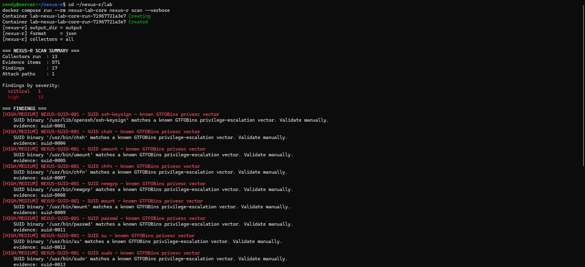
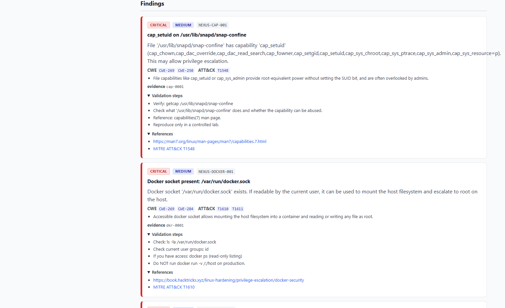
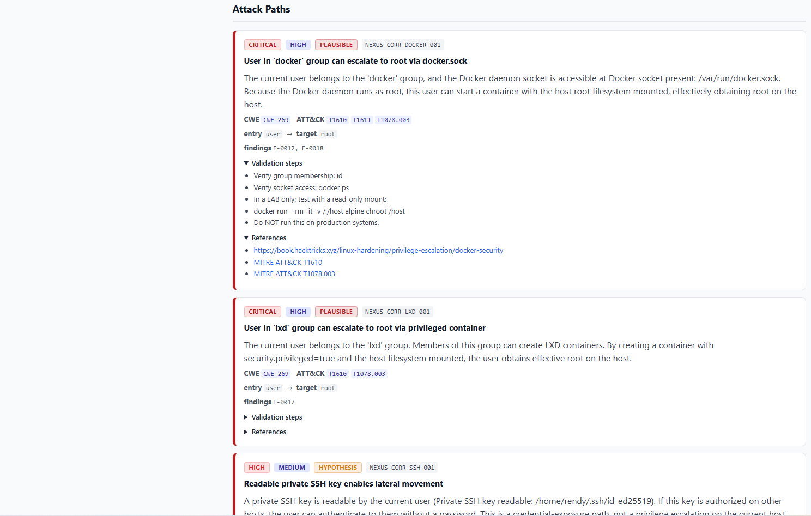
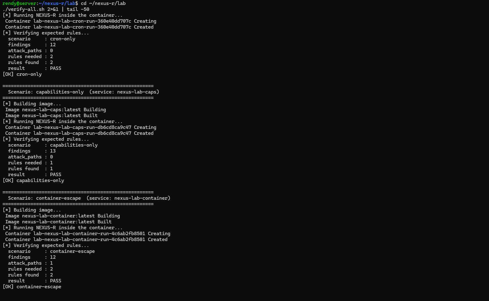

<h1 align="center">NEXUS-R</h1>

<p align="center">
  <strong>Evidence-Driven Linux Security Research and Privilege-Escalation Analysis Engine</strong>
</p>

<p align="center">
  <a href="https://github.com/rndy4dty/nexus-r/releases"></a>
  <a href="https://www.python.org/"></a>
  <a href="LICENSE"></a>
  <a href="tests/"></a>
  <a href="src/nexus_r/analysis/rules/"></a>
  <a href="src/nexus_r/collectors/"></a>
  <a href="docs/adr/"></a>
</p>

<p align="center">
  <a href="#overview">Overview</a> ·
  <a href="#why-nexus-r">Why NEXUS-R</a> ·
  <a href="#features">Features</a> ·
  <a href="#screenshots">Screenshots</a> ·
  <a href="#installation">Installation</a> ·
  <a href="#usage">Usage</a> ·
  <a href="#report-formats">Reports</a> ·
  <a href="#architecture">Architecture</a> ·
  <a href="#detection-coverage">Detection</a> ·
  <a href="#cve-database">CVE</a> ·
  <a href="#ai-hypothesis-layer">AI Layer</a> ·
  <a href="#lab-environment">Lab</a> ·
  <a href="#documentation">Documentation</a> ·
  <a href="#development">Development</a>
</p>

---

## Overview

**NEXUS-R** is an evidence-driven Linux security research engine. It collects facts from a target system, normalizes them into **structured evidence**, analyzes them through a **deterministic rule engine**, correlates findings into **attack paths**, and enriches the result with **CWE / MITRE ATT&CK** mappings plus optional **AI hypotheses** that always require human validation.

NEXUS-R focuses on **correlation, explainability, and reasoning**. Rather than simply producing a list of findings, it connects individual observations and security weaknesses into an understandable picture of how an attacker could potentially escalate privileges.

### Key Characteristics

- **Evidence-first** — every finding traces back to evidence and a rule.
- **Deterministic** — the same evidence always produces the same findings.
- **Explainable** — each finding carries severity, confidence, validation steps, CWE, and MITRE ATT&CK references.
- **Attack-path aware** — correlated findings become concrete escalation paths.
- **AI-assisted, not AI-driven** — the optional hypothesis layer never creates findings, only comments on them.

---

## Why NEXUS-R

Most Linux enumeration tools present findings as a flat list. The analyst is expected to combine them into a mental picture. NEXUS-R focuses on three areas.

### 1. Evidence-First, Deterministic Analysis

Every finding is traceable back to the evidence and the rule that produced it.

- The same scan produces the same output every time.
- Rule IDs are stable, so filters, ignore-lists, and CI gates can rely on them.
- Findings are safe to diff between two runs.
- AI is not part of the deterministic detection path.

### 2. Severity ≠ Confidence

NEXUS-R keeps two independent axes:

| Axis | Meaning |
|---|---|
| **Severity** | Potential impact if the finding is valid |
| **Confidence** | Strength of the evidence supporting the finding |

A finding with `severity: high, confidence: low` means the potential impact may be significant while the available evidence is incomplete and requires validation.

### 3. Attack Paths

Combinations of findings — such as a user belonging to the `docker` group combined with an accessible Docker socket — can be represented as concrete attack paths containing:

- A narrative explaining the combination
- An entry point and target (`user → root`)
- Validation steps for the analyst
- A status such as `plausible` or `hypothesis`
- References to the findings that compose the path

This allows NEXUS-R to move beyond flat enumeration results toward evidence-based correlation.

---

## Features

| Category | Detail |
|---|---|
| **Collectors** | 13 — system, kernel, users, sudo, suid, capabilities, cron, writable, environment, docker, services, systemd, packages |
| **Detection rules** | 15 — SUID/SGID, sudo NOPASSWD, dangerous sudo, file capabilities, writable cron, cron PATH hijack, writable sensitive files, writable PATH entries, outdated kernel, Docker socket, dangerous groups, SSH keys, writable systemd units, CVE packages |
| **Correlation rules** | 3 — Docker group + socket, LXD group, SSH key lateral movement |
| **CVE database** | 26 curated entries focused on 2023–2024 |
| **Knowledge engine** | CWE and MITRE ATT&CK mappings |
| **AI hypothesis layer** | Offline template + Ollama + OpenAI-compatible backends |
| **Report formats** | JSON, HTML, SARIF 2.1.0, Markdown |
| **Lab** | 5 Docker scenarios with automated verification |
| **Test suite** | 248 unit tests |

---

## Screenshots

### Terminal — NEXUS-R Scan Output

Real scan output on a live Ubuntu 24.04 system, showing collectors, evidence items, findings, attack paths, and hypotheses.



---

### HTML Report — Summary

Self-contained HTML report with summary cards, severity distribution, confidence distribution, and a full table of findings. No CDN or external assets are required.


---

### HTML Report — Findings

Each finding is rendered with severity and confidence, rule identifier, evidence references, CWE and MITRE ATT&CK mappings, validation steps, and references.



---

### HTML Report — Attack Paths

Attack paths are rendered with a distinct visual treatment. Each card shows the combined findings, entry point, target, narrative, and validation steps.



---

### Lab Verification — 5 Scenarios

Automated verification of all five lab scenarios:

- `core`
- `sudo-only`
- `cron-only`
- `capabilities-only`
- `container-escape`



---

### GitHub Repository

Repository view with README, release tags, screenshots, and project history.


---

## Installation

### Option 1 — Install from GitHub

```bash
uv tool install git+https://github.com/rndy4dty/nexus-r.git
nexus-r version
```

Pin to a specific release:

```bash
uv tool install git+https://github.com/rndy4dty/nexus-r.git@v0.7.0
```

### Option 2 — Clone and Run from Source

```bash
git clone https://github.com/rndy4dty/nexus-r.git
cd nexus-r
uv sync
uv run nexus-r scan
```

### Requirements

- Linux target environment
- Python 3.12+
- uv Python package manager

### Optional Dependencies

For the CVE rule (NEXUS-PKG-001), NEXUS-R reads:

```text
/var/lib/dpkg/status
```

On Debian/Ubuntu systems this file is normally world-readable, so no root access is required for this collector.

For the capabilities rule (NEXUS-CAP-001), `getcap` is used when available:

```bash
sudo apt install libcap2-bin
```

For the AI hypothesis layer with Ollama:

```bash
curl -fsSL https://ollama.com/install.sh | sh
ollama pull llama3.2
```

---

## Usage

### Basic Scan

```bash
uv run nexus-r scan
```

Example output:

```text
=== NEXUS-R SCAN SUMMARY ===
Collectors run  : 13
Evidence items  : 1733
Findings        : 21
Attack paths    : 3
Hypotheses      : 4

Findings by severity:
  critical   4
  high       13
  medium     4

=== ATTACK PATHS ===
[CRITICAL/HIGH] NEXUS-CORR-DOCKER-001
    User in 'docker' group can escalate to root via docker.sock
    entry: user → target: root
    findings: F-0012, F-0015

=== HYPOTHESES ===
[CRITICAL/MEDIUM] H-0001
    container-escape: 2 finding(s)
    mode    : template
    status  : needs_review
    findings: F-0012, F-0013

JSON report : output/report.json
HTML report : output/report.html
SARIF report: output/report.sarif
MD report   : output/report.md
```

### Run a Subset of Collectors

```bash
uv run nexus-r scan -c system -c users -c suid
```

### Enable the AI Hypothesis Layer

Offline template mode:

```bash
uv run nexus-r scan
```

Local Ollama:

```bash
uv run nexus-r scan --ai --ai-backend ollama --ai-model llama3.2
```

OpenAI-compatible API:

```bash
uv run nexus-r scan --ai --ai-backend openai --ai-model gpt-4o-mini
```

The AI layer never creates new findings. It only comments on findings that already exist, and every hypothesis has status `needs_review`. Human validation is mandatory.

See ADR-004.

### CLI Reference

```text
nexus-r scan [OPTIONS]

  -o, --output PATH
      Output directory (default: output)

  -f, --format TEXT
      Report format (default: json)

  -c, --collector TEXT
      Run only the named collector(s); repeatable

  -v, --verbose
      Print progress information

      --show-findings / --no-show-findings
      Show or hide findings

      --show-paths / --no-show-paths
      Show or hide attack paths

      --ai
      Enable the AI hypothesis layer

      --ai-backend TEXT
      template | ollama | openai

      --ai-model TEXT
      Model name for the AI backend
```

---

## Report Formats

Each scan can produce four report formats in the output directory.

| Format | File | Purpose |
|---|---|---|
| JSON | `output/report.json` | Programmatic consumption, diffing, CI |
| HTML | `output/report.html` | Visual review in a browser |
| SARIF | `output/report.sarif` | GitHub Code Scanning and GitLab SAST |
| Markdown | `output/report.md` | Written security reports |

### JSON Structure

```json
{
  "nexus_r_version": "0.7.0",
  "generated_at": "2026-10-01T...",
  "scan": {
    "collectors_run": ["system", "kernel"],
    "collectors_failed": []
  },
  "evidence": [],
  "findings": [],
  "attack_paths": [],
  "hypotheses": [],
  "summary": {
    "evidence_count": 1733,
    "finding_count": 21,
    "attack_path_count": 3,
    "hypothesis_count": 4,
    "findings_by_severity": {
      "critical": 4,
      "high": 13,
      "medium": 4
    }
  }
}
```

---

## Architecture

```text
CLI / Configuration
        │
        ▼
Scan Orchestrator
        │
        ▼
Collectors ────► EvidenceStore
        │              │
        │              ▼
        │         RuleEngine ──────► Findings
        │              │
        │              ▼
        │     CorrelationEngine ───► AttackPaths
        │              │
        │              ▼
        │     Knowledge (CWE / ATT&CK)
        │              │
        │              ▼
        │     Hypothesis Layer (optional)
        │              │
        ▼              ▼
JSON / HTML / SARIF / Markdown
```

### Layer Responsibilities

| Layer | Responsibility | Cannot Do |
|---|---|---|
| Collectors | Acquire facts from the system | Judge vulnerability |
| EvidenceStore | Store structured observations | Analyze |
| RuleEngine | Evaluate rules against evidence | Change evidence |
| CorrelationEngine | Combine findings into attack paths | Invent findings |
| Knowledge | Map rules to CWE / ATT&CK | Produce findings |
| AI Hypothesis | Comment on existing findings | Produce findings |
| Report | Serialize the report | Analyze |

Every finding and attack path is traceable to its evidence. Every AI hypothesis references at least one existing finding.

### Package Layout

```text
src/nexus_r/
├── cli.py
├── orchestrator.py
├── config.py
├── collectors/
│   ├── system.py
│   ├── kernel.py
│   ├── users.py
│   ├── sudo.py
│   ├── suid.py
│   ├── capabilities.py
│   ├── cron.py
│   ├── writable.py
│   ├── environment.py
│   ├── docker.py
│   ├── services.py
│   ├── systemd.py
│   └── packages.py
├── evidence/
├── analysis/
│   ├── finding.py
│   ├── rule.py
│   ├── engine.py
│   ├── rules/
│   └── correlation/
├── knowledge/
├── ai/
├── report/
└── utils/
```

---

## Detection Coverage

### Detection Rules

| Rule ID | Category | Severity | Confidence |
|---|---|---|---|
| NEXUS-SUID-001 | SUID binary matching GTFOBins | high | medium |
| NEXUS-SGID-001 | SGID binary present | info | high |
| NEXUS-SUDO-001 | Sudo NOPASSWD entry | high | high |
| NEXUS-SUDO-002 | Dangerous sudo entry | high | medium |
| NEXUS-CAP-001 | Dangerous file capability | critical | medium |
| NEXUS-CRON-001 | Writable cron script | high | high |
| NEXUS-CRON-002 | Cron PATH hijack candidate | medium | low |
| NEXUS-WRITE-001 | Writable sensitive file | critical | high |
| NEXUS-PATH-001 | Writable directory in `$PATH` | high | high |
| NEXUS-KERN-001 | Outdated kernel heuristic | medium | low |
| NEXUS-DOCKER-001 | Docker socket accessible | critical | medium |
| NEXUS-GROUP-001 | User in a dangerous group | critical | medium |
| NEXUS-SSH-001 | Readable private SSH key | high | medium |
| NEXUS-SYSD-001 | Writable systemd unit file | high | high |
| NEXUS-PKG-001 | Installed package with a known CVE | high | medium |

### Correlation Rules

| Rule ID | Combination | Status | Severity |
|---|---|---|---|
| NEXUS-CORR-DOCKER-001 | Docker group + `docker.sock` → root | plausible | critical |
| NEXUS-CORR-LXD-001 | LXD/LXC group → root | plausible | critical |
| NEXUS-CORR-SSH-001 | Readable SSH key → lateral movement | hypothesis | high |

---

## CVE Database

The curated CVE database contains 26 entries focused on 2023–2024 and covers vulnerabilities relevant to Linux security research, privilege escalation, remote code execution, container security, and related attack surfaces.

All entries include an NVD reference and are matched against `/var/lib/dpkg/status`.

### Example Entries

| CVE | Package | Nickname | Severity | Year |
|---|---|---|---|---|
| CVE-2024-6387 | openssh-server | regreSSHion | critical | 2024 |
| CVE-2024-6409 | openssh-server | regreSSHion (privsep) | high | 2024 |
| CVE-2024-3094 | xz-utils | xz backdoor | critical | 2024 |
| CVE-2024-21626 | runc | container escape | high | 2024 |
| CVE-2024-1086 | linux-image-generic | nf_tables UAF | high | 2024 |
| CVE-2024-26581 | linux-image-generic | nft_set_rbtree | high | 2024 |
| CVE-2024-2961 | glibc | iconv buffer overflow | high | 2024 |
| CVE-2024-4577 | php | PHP CGI argument injection | critical | 2024 |
| CVE-2024-47176 | cups-browsed | CUPS chain | high | 2024 |
| CVE-2024-47076 | libcupsfilters | CUPS chain | high | 2024 |
| CVE-2024-47175 | libppd | CUPS chain | high | 2024 |
| CVE-2024-47177 | cups-filters | CUPS chain | high | 2024 |
| CVE-2024-27316 | apache2 | HTTP/2 memory exhaustion | high | 2024 |
| CVE-2024-32487 | less | filename injection | medium | 2024 |
| CVE-2023-22809 | sudo | sudoedit bypass | high | 2023 |
| CVE-2023-4911 | glibc | Looney Tunables | high | 2023 |
| CVE-2023-38408 | openssh-client | ssh-agent PKCS#11 RCE | high | 2023 |
| CVE-2023-26604 | systemd | systemctl pager privesc | medium | 2023 |
| CVE-2023-38545 | curl | SOCKS5 heap overflow | high | 2023 |
| CVE-2023-2454 | postgresql-14 | schema_element privesc | medium | 2023 |
| CVE-2023-24329 | python3.10 | urllib URL bypass | medium | 2023 |
| CVE-2023-0386 | linux-image-generic | OverlayFS privesc | high | 2023 |
| CVE-2023-32233 | linux-image-generic | nf_tables UAF | high | 2023 |
| CVE-2023-35001 | linux-image-generic | nftables nft_byteorder | high | 2023 |
| CVE-2023-39325 | golang-go | HTTP/2 Rapid Reset | high | 2023 |
| CVE-2023-44487 | apache2 | HTTP/2 Rapid Reset | high | 2023 |

### Version Comparison

NEXUS-R's package version comparison is best-effort. It handles:

- Epoch prefixes such as `1:9.6p1-3ubuntu13.19`
- Ubuntu's `+really` convention
- Optional range matching through `affected_above`

It does not implement Debian Policy §5.6.12 in full, and it cannot detect all distro backports from version strings alone.

All NEXUS-PKG-001 findings use `confidence: medium`.

See ADR-005.

---

## AI Hypothesis Layer

NEXUS-R supports an optional AI hypothesis layer that produces a narrative and validation steps for findings that already exist.

### Backend Modes

| Backend | How It Runs | Requirements |
|---|---|---|
| `template` | Offline, in-process, deterministic | None |
| `ollama` | HTTP to `localhost:11434` | `ollama serve` + model |
| `openai` | OpenAI-compatible API | `OPENAI_API_KEY` |

### Safety Guarantees

- Every hypothesis must reference at least one existing finding.
- Every hypothesis has status `needs_review`.
- The AI backend has no direct access to the filesystem, evidence store, or collectors.
- If the AI backend is unreachable, the analyzer falls back to the offline template.

### Example Hypothesis

```json
{
  "id": "H-0001",
  "finding_ids": ["F-0012", "F-0013"],
  "mode": "template",
  "model": "template",
  "title": "container-escape: 2 finding(s)",
  "narrative": "Findings in this category may allow escaping a container...",
  "severity": "critical",
  "confidence": "medium",
  "status": "needs_review",
  "validation_steps": [
    "Verify the current user's groups: id",
    "Verify socket access: ls -la /var/run/docker.sock"
  ]
}
```

See ADR-004.

---

## Lab Environment

The `lab/` directory contains five Docker scenarios built on intentionally vulnerable Linux containers.

| Scenario | Service | Focus | Rules Verified |
|---|---|---|---|
| `core` | `nexus-lab-core` | Mixed vulnerabilities | 7 rules |
| `sudo-only` | `nexus-lab-sudo` | Sudo misconfiguration | NEXUS-SUDO-001, NEXUS-SUDO-002 |
| `cron-only` | `nexus-lab-cron` | Writable cron + PATH | NEXUS-CRON-001, NEXUS-PATH-001 |
| `capabilities-only` | `nexus-lab-caps` | File capabilities | NEXUS-CAP-001 |
| `container-escape` | `nexus-lab-container` | Docker group + socket | NEXUS-GROUP-001, NEXUS-DOCKER-001, NEXUS-CORR-DOCKER-001 |

### Running the Lab

```bash
cd lab
docker compose build
./verify-all.sh
```

Expected output should report `PASS` for every scenario followed by:

```text
All scenarios passed.
```

> **Warning:** The lab images intentionally contain vulnerabilities. Do not deploy them anywhere except an isolated lab environment.

See `lab/README.md`.

---

## Documentation

### Architecture Decision Records

| ADR | Title | Status |
|---|---|---|
| ADR-001 | Project Architecture & Scope | Accepted |
| ADR-002 | Detection Coverage & Finding Model | Accepted |
| ADR-003 | Attack Path Model & Correlation | Accepted |
| ADR-004 | AI Hypothesis Layer | Accepted |
| ADR-005 | Version Comparison Limits | Accepted |

### Other Documents

- `docs/roadmap.md` — roadmap from V0.1 to V1.0
- `CHANGELOG.md` — version history

---

## Development

### Setup

```bash
git clone https://github.com/rndy4dty/nexus-r.git
cd nexus-r
uv sync
```

### Tests

```bash
uv run pytest -q
uv run pytest tests/unit -q
uv run pytest --collect-only -q
```

### Lint and Format

```bash
uv run ruff check .
uv run ruff format .
```

### Build

```bash
uv build
ls dist/
```

### Project Structure

```text
nexus-r/
├── src/nexus_r/
│   ├── cli.py
│   ├── orchestrator.py
│   ├── config.py
│   ├── collectors/               # 13 collectors
│   ├── evidence/                 # Evidence model + store
│   ├── analysis/
│   │   ├── finding.py
│   │   ├── rule.py
│   │   ├── engine.py
│   │   ├── rules/                # Detection rules
│   │   └── correlation/          # Correlation rules
│   ├── knowledge/                # CWE / ATT&CK / CVE
│   ├── ai/                       # AI hypothesis layer
│   ├── report/                   # JSON / HTML / SARIF / Markdown
│   └── utils/
├── tests/
├── docs/
├── lab/
├── pyproject.toml
└── README.md
```
